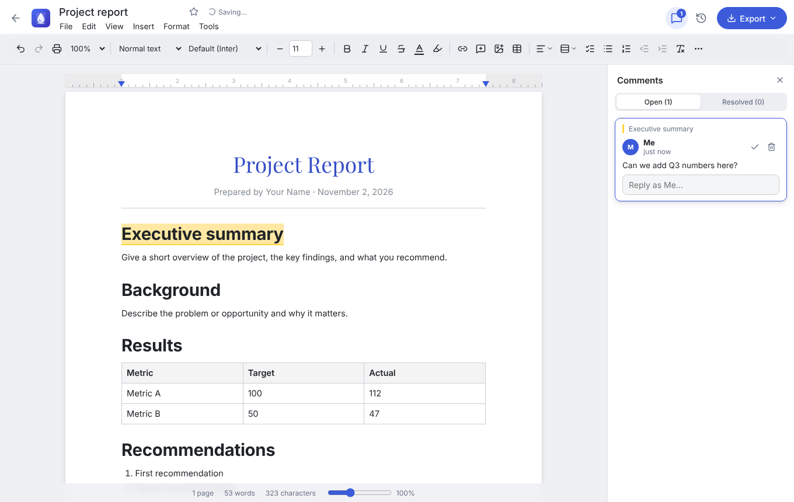
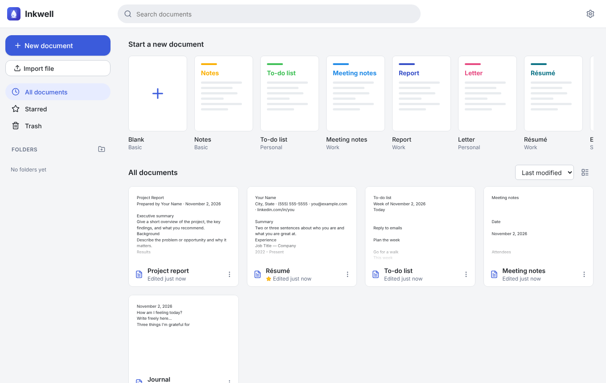
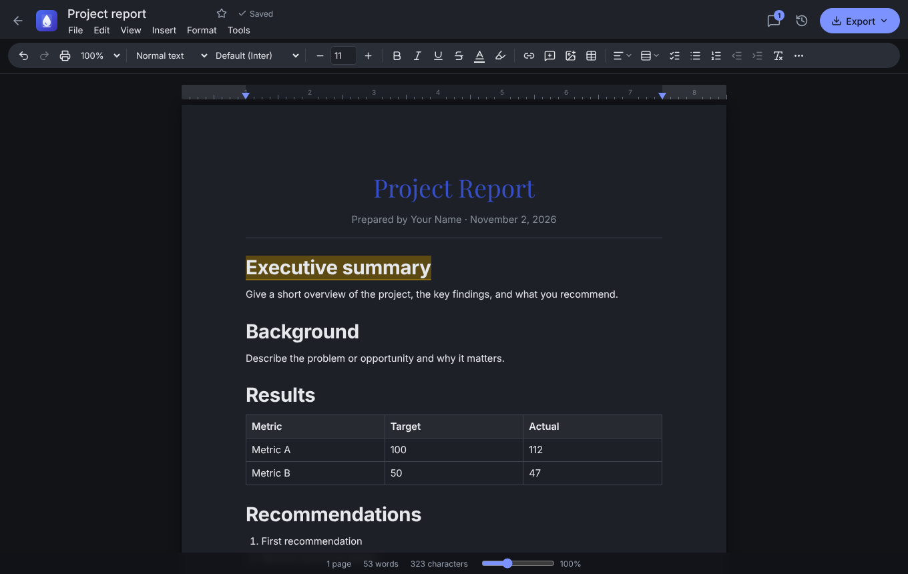
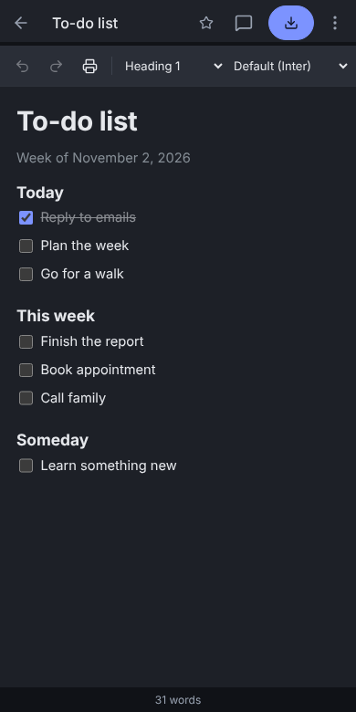

<p align="center">
  
</p>

<h1 align="center">Inkwell</h1>

<p align="center">
  A word processor and note-taking app for <b>Mac, Windows, Linux, iPhone/iPad, Android and the web</b>.<br>
  It combines the simplicity of Google Docs, the formatting power of Microsoft Word and the templates of Apple Pages.<br>
  It works offline, and your documents stay on your device.
</p>

<p align="center">
  <a href="#-download--install">Download</a> ·
  <a href="#-features">Features</a> ·
  <a href="#%EF%B8%8F-build-it-yourself">Build from source</a> ·
  <a href="#-publishing-a-release-for-the-repo-owner">Publish a release</a>
</p>



| Document library | Dark mode | On a phone |
|---|---|---|
|  |  |  |

---

## ⬇️ Download & install

All installers are on the **[Releases page](https://github.com/tkfam151/notetaking-app/releases/latest)**. Download the file for your device:

| Your device | File to download |
|---|---|
| 🍎 **Mac** (Intel or Apple Silicon) | `Inkwell-x.y.z-mac.dmg` |
| 🪟 **Windows** 10 / 11 | `Inkwell-x.y.z-windows-setup.exe` |
| 🐧 **Linux** | `Inkwell-x.y.z-linux-x86_64.AppImage` or `.deb` |
| 🤖 **Android** phone or tablet | `Inkwell-x.y.z-android.apk` |
| 📱 **iPhone / iPad** | Use the web app (see below), or `Inkwell-x.y.z-ios-unsigned.ipa` |
| 🌐 **Any browser** | Open the [web app](https://tkfam151.github.io/notetaking-app/) |

> **Why do I see security warnings?** Inkwell is free and isn't signed with a paid Apple or Microsoft developer certificate, so your computer doesn't recognise the publisher. The steps below show how to open it safely. This is a one-time step.

### 🍎 Mac

1. Download **`Inkwell-…-mac.dmg`** and double-click it.
2. Drag **Inkwell** into your **Applications** folder.
3. Open **Applications** and **right-click → Open** on Inkwell, then click **Open** again.
   - On macOS 15 (Sequoia) or later: if it says the app can't be opened, go to **System Settings → Privacy & Security**, scroll down and click **Open Anyway** next to Inkwell.
   - If it says the app is **"damaged"**, open **Terminal** and run the command below, then open the app again:
     ```bash
     xattr -cr /Applications/Inkwell.app
     ```
   - If it still won't open (common on Apple Silicon Macs), this copies the app into your
     user Applications folder without the download quarantine, re-signs it locally and opens it:
     ```bash
     pkill -9 -f "Inkwell"; mkdir -p ~/Applications; rm -rf ~/Applications/Inkwell.app; ditto --noextattr --noqtn /Applications/Inkwell.app ~/Applications/Inkwell.app && codesign --force --deep --sign - ~/Applications/Inkwell.app && open ~/Applications/Inkwell.app
     ```
     From then on, open Inkwell from the **Applications** folder inside your home folder.

### 🪟 Windows

1. Download **`Inkwell-…-windows-setup.exe`** and double-click it.
2. If you see **"Windows protected your PC"**, click **More info → Run anyway**.
3. Follow the installer. Inkwell appears in the Start menu and on your desktop.

### 🐧 Linux

- **AppImage** (works on any distribution):
  ```bash
  chmod +x Inkwell-*.AppImage
  ./Inkwell-*.AppImage
  ```
- **Debian / Ubuntu**:
  ```bash
  sudo apt install ./Inkwell-*.deb
  ```

### 🤖 Android

1. On your phone, open the [Releases page](https://github.com/tkfam151/notetaking-app/releases/latest) and download **`Inkwell-…-android.apk`**.
2. Tap the downloaded file. If Android asks, allow your browser to **Install unknown apps**.
3. Tap **Install**, then **Open**.

### 📱 iPhone & iPad

Apple only allows apps to be installed from the App Store, so choose one of these:

**Option A — Web app (easiest, recommended)**
1. Open **[tkfam151.github.io/notetaking-app](https://tkfam151.github.io/notetaking-app/)** in **Safari**.
2. Tap the **Share** button, then **Add to Home Screen**, then **Add**.
3. Inkwell now has its own icon, opens full-screen and works offline, like a regular app.

**Option B — Install the real app with a free Apple ID (sideloading)**
1. On a Mac or PC, install [Sideloadly](https://sideloadly.io) or [AltStore](https://altstore.io).
2. Download **`Inkwell-…-ios-unsigned.ipa`** from the Releases page.
3. Connect your iPhone, drag the `.ipa` into Sideloadly or AltStore and sign in with your Apple ID.
4. On the iPhone, go to **Settings → General → VPN & Device Management** and trust your Apple ID.
   *(Apps signed with a free Apple ID must be refreshed every 7 days. AltStore can do this automatically.)*

**Option C — App Store / TestFlight**
This needs a paid [Apple Developer account](https://developer.apple.com/programs/) ($99/year). See [Building for iPhone](#iphone--ipad-needs-a-mac) below.

### 🌐 Web

Open **[tkfam151.github.io/notetaking-app](https://tkfam151.github.io/notetaking-app/)** in Chrome, Edge, Safari or Firefox. In Chrome or Edge you can click the **Install** icon in the address bar to get a desktop app window.

---

## ✨ Features

**Writing and formatting** (like Word)
- Fonts, sizes, bold, italic, underline, strikethrough, superscript and subscript
- Text colour, highlight colour, alignment and line spacing
- Headings, bulleted, numbered and nested lists, checklists, quotes, code blocks
- Tables (insert, add or delete rows and columns, merge or split cells, resize columns)
- Images (insert, paste or drag-and-drop, then resize), links, horizontal lines, page breaks
- Special characters, and the date or time inserted with one click
- Markdown-style shortcuts: type `# ` for a heading, `- ` for a list, `[ ] ` for a checklist, `> ` for a quote

**Drawing** (like Pages and Word's Draw tab)
- Click **Draw** on the toolbar (or **Insert → Drawing…**) to sketch with a mouse, finger or stylus. Apple Pencil and other pressure-sensitive pens draw thicker when you press harder
- Pen, highlighter, eraser, lines, arrows, rectangles and ellipses (filled or outlined), 9 colours plus a custom colour, 4 brush sizes, undo and redo
- White, grid or transparent background. Hold **Shift** for straight lines, squares and circles
- Drawings sit in the document like images: resize them, and they export to Word and PDF. **Double-click** a drawing to keep editing it

**Page layout** (like Word and Pages)
- Page view with Letter, A4 or Legal paper, portrait or landscape, and custom margins
- A draggable ruler for the left and right margins, page boundary markers, and zoom from 50% to 200%
- **Pageless** mode for distraction-free writing (like Google Docs)
- Print with real page breaks

**Documents and organisation** (like Google Docs)
- Autosaves as you type, even offline
- Home screen with search, sorting, folders, starred documents and a trash you can restore from
- **Version history**: automatic snapshots, named versions, preview and one-click restore
- **Comments**: comment on any text, reply, resolve and re-open
- Find & replace (match case, whole words), and word count with reading time

**Accounts and sharing** (web version only; the apps stay account-free)
- Sign in with email and password, or with an emailed sign-in link
- **Share** a document with people by email as **Viewer** or **Editor**, or turn on **"Anyone with the link can view / edit"**
- Documents shared with you appear under **Shared**. Changes sync when you open a document, return to the tab, or every 15 seconds; there is no live typing together
- Viewers get a read-only page. If the owner removes you, you keep a private copy

**Templates** (like Pages)
- Blank, Notes, To-do list, Meeting notes, Report, Letter, Résumé, Essay, Journal and Class notes

**Import and export**
- Export to **Word (.docx)**, **PDF**, **Markdown**, **HTML**, **plain text** and Inkwell's own format
- Import **Word (.docx)**, Markdown, HTML and text files (drag a file onto the home screen)
- Back up and restore all your documents from **Settings**

**Everywhere**
- Light, dark or system theme
- Adapts to phones and tablets
- Works fully offline, with no account and no tracking

### Keyboard shortcuts

`Ctrl` on Windows and Linux is `⌘` on Mac.

| Action | Shortcut |
|---|---|
| Bold / Italic / Underline | `Ctrl+B` / `Ctrl+I` / `Ctrl+U` |
| Heading 1–4 / Normal text | `Ctrl+Alt+1…4` / `Ctrl+Alt+0` |
| Bulleted / Numbered list / Checklist | `Ctrl+Shift+8` / `Ctrl+Shift+7` / `Ctrl+Shift+9` |
| Insert link / Add comment | `Ctrl+K` / `Ctrl+Alt+M` |
| Page break | `Ctrl+Enter` |
| Find / Find & replace | `Ctrl+F` / `Ctrl+H` |
| Save a version / Print | `Ctrl+S` / `Ctrl+P` |

The full list is under **Tools → Keyboard shortcuts** in the app.

### Where are my documents stored?

Everything is saved privately **on your device**, in the app's local database. Nothing is uploaded anywhere. To move your documents to another device, use **Settings → Download backup**, then **Restore from backup** on the other device. You can also export any document as a Word, PDF or other file.

---

## 🛠️ Build it yourself

**You need:** [Node.js 22+](https://nodejs.org) and [Git](https://git-scm.com).

```bash
git clone https://github.com/tkfam151/notetaking-app.git
cd notetaking-app
npm install
npm run dev          # opens the web app at http://localhost:5173
```

### Desktop (Mac / Windows / Linux)

```bash
npm run electron:dev   # run the desktop app
npm run dist:mac       # → release/Inkwell-x.y.z-mac.dmg        (must run on a Mac)
npm run dist:win       # → release/Inkwell-x.y.z-windows-setup.exe
npm run dist:linux     # → release/Inkwell-x.y.z-linux-x86_64.AppImage and .deb
```

### Android (needs [Android Studio](https://developer.android.com/studio))

```bash
npm run android:open   # builds the web app, syncs it, and opens Android Studio
```
In Android Studio, press **Run ▶** to install on a connected phone or emulator, or choose **Build → Build APK(s)**.

### iPhone / iPad (needs a Mac)

You need a Mac with [Xcode](https://apps.apple.com/app/xcode/id497799835).

```bash
npm run ios:open       # builds the web app, syncs it, and opens Xcode
```
In Xcode, select the **App** target, open **Signing & Capabilities** and choose your team. A free Apple ID works for your own phone. Then press **Run ▶**. To publish to the App Store or TestFlight, use **Product → Archive** with a paid developer account.

### Tests

```bash
npm run build
npx vite preview --port 4173 &
npm test               # end-to-end test in a real browser (needs Playwright: npm i -D playwright && npx playwright install chromium)
```

### Project layout

```
src/                 The app (React + TypeScript), shared by every platform
  components/        Screens and UI: library, editor, toolbar, menus, comments, history…
  editor/            Editor setup and custom features (page breaks, comments, find & replace)
  lib/               Storage (IndexedDB), import/export (docx, pdf, md…), templates
  styles/            App and document styles, including print
electron/            Desktop wrapper (Mac, Windows, Linux)
android/  ios/       Native mobile projects (Capacitor)
public/              Icons and web-app files
scripts/             Icon generator and the end-to-end smoke test
.github/workflows/   Automatic builds for every platform
```

**Built with:** [React](https://react.dev), [TipTap / ProseMirror](https://tiptap.dev) (the editor), [Electron](https://electronjs.org) (desktop), [Capacitor](https://capacitorjs.com) (iOS and Android), [Vite](https://vitejs.dev), [docx](https://docx.js.org), [mammoth](https://github.com/mwilliamson/mammoth.js) and [html2pdf.js](https://github.com/eKoopmans/html2pdf.js).

---

## 🚀 Publishing a release (for the repo owner)

GitHub builds every installer automatically. You don't need a Mac or Windows PC.

1. **One-time setup, for the web app:** in the repository, go to **Settings → Pages → Build and deployment → Source** and choose **GitHub Actions**. The web app then deploys to `https://tkfam151.github.io/notetaking-app/` on every push to `main`.
   Don't add GitHub's Jekyll workflow: Inkwell is already a built app, and Jekyll would replace it with the README.
2. **Make a release:** change `"version"` in `package.json` (for example to `1.0.1`), commit, and push to `main`.
   (Pushing a tag such as `v1.0.1` also works.)
3. Open the **Actions** tab and wait roughly 15–20 minutes. The **Build & Release** workflow builds the macOS, Windows, Linux, Android, iOS and web versions, then creates a **Release** tagged `v1.0.1` with all the files attached. That's the link you share.

You can also run **Build & Release** by hand (**Actions → Build & Release → Run workflow**) to get the files as downloadable artifacts without making a release.

---

## 🔐 Accounts and sharing (web version)

Sign-in and sharing only exist in the **web version**. The Mac, Windows, Linux, iPhone and Android apps never ask you to sign in.
Until you complete these steps, the web version works exactly like the apps: no login, documents saved in the browser.

It uses [Supabase](https://supabase.com) for accounts and shared documents. The free plan is enough to start.

1. **Create a project:** sign up at [supabase.com](https://supabase.com), click **New project**, pick a name and a database password, and wait about a minute.
2. **Create the tables:** in the project, open **SQL Editor → New query**, paste the whole of [`supabase/schema.sql`](supabase/schema.sql), and click **Run**.
3. **Set the website address:** go to **Authentication → URL Configuration**:
   - **Site URL:** `https://tkfam151.github.io/notetaking-app/`
   - **Redirect URLs:** add `https://tkfam151.github.io/notetaking-app/**`
4. **Copy two values:** go to **Project Settings → API** (or **Data API**) and copy the **Project URL** and the **anon / public** key. Both are safe to make public; the database rules decide who can see what.
5. **Give them to GitHub:** in this repository go to **Settings → Secrets and variables → Actions → Variables → New repository variable** and add:
   - `SUPABASE_URL`, set to the Project URL
   - `SUPABASE_ANON_KEY`, set to the anon key
6. **Redeploy:** open **Actions → Deploy web app → Run workflow**. When it finishes, the website shows the sign-in page.

Notes:
- New accounts must click a confirmation email. To turn that off while testing: **Authentication → Providers → Email → Confirm email**.
- Supabase's built-in email sender is limited to a few emails per hour. For real use, add your own SMTP server under **Authentication → Emails**.
- Inkwell doesn't email the people you invite. Send them the link from the **Share** window, and they sign in with the address you invited.
- How it's protected: the database's row-level security rules decide who can read and write each document, and link-shared documents can't be listed or searched for. These rules are tested on every push (`supabase/tests/rls.test.sql`).

---

## Current limitations

- **No live co-editing.** Shared documents (web version) sync every few seconds, not keystroke by keystroke. If two people edit at the same moment, the last save wins. Your own unshared documents live on each device; use backup and restore to move them.
- **Page view is approximate on screen.** Page boundaries are shown as markers on one continuous sheet. Exact page layout happens when you print or export to PDF or Word.
- **Unsigned builds.** See the install notes above for the one-time security prompts. Signing needs paid Apple ($99/yr) and Windows code-signing certificates.
